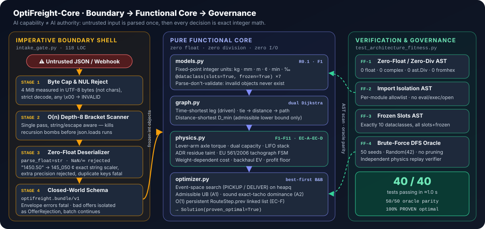
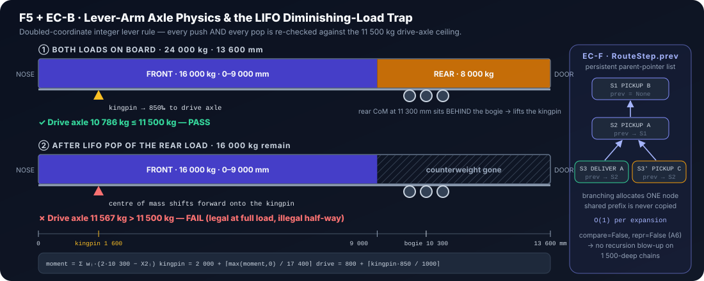

<div align="center">

# 🚛 OptiFreight-Core

### Deterministic Zero-Float Multi-Stop LTL Freight Dispatcher & Route Optimizer

[](#)
[-10B981?style=for-the-badge)](#silicon-up-engineering-highlights)
[-6366F1?style=for-the-badge)](#)
[](#verification--benchmark-ledger)

*Architected for high-assurance logistics dispatch where **AI Capability $\neq$ AI Authority**: untrusted JSON payloads are quarantined at a four-stage zero-float boundary gate, and every routing, axle-torque, and tachograph decision is proven optimal in exact 64-bit integer arithmetic.*

</div>

---

## 1. Executive Thesis: Why `OptiFreight-Core` Exists

Modern freight brokerages increasingly use LLMs to extract spot-market shipment tenders from emails, PDFs, and webhooks. Yet **handing an LLM authority to commit a 40-tonne articulated semi-trailer to a multi-stop European LTL route is an operational catastrophe**:

1. **The Diminishing-Load Axle Trap (`EC-B`):** A 24,000 kg load that is 100% legal at departure (`10,786 kg` on the tractor drive axle) can become **illegal mid-route (`11,567 kg > 11,500 kg`)** the moment an intermediate rear pallet group is unloaded at a stop—because removing weight behind the trailer's rear tri-axle bogie (`10,300 mm`) removes upward lever counter-torque on the fifth-wheel kingpin (`1,600 mm`).
2. **Floating-Point Instability in Branch-and-Bound:** In dominance-pruned search trees, `0.1 + 0.2 != 0.3` and FMA drift across x86-64 vs. ARM64 cause two identical processes to prune different branches, silently dropping optimal routes or violating cross-node audit reproducibility.
3. **EU Regulation (EC) No 561/2006 Tachograph Coupling:** Driving budgets (`270 min` continuous, `540 min` daily), mandatory `45 min` breaks, `660 min` overnight rests, and `900 min` shift amplitude windows interact non-monotonically with warehouse dock waiting times.

**`OptiFreight-Core`** solves this by enforcing a strict **Imperative Boundary Shell $\to$ Pure Functional Core $\to$ Continuous AST & Oracle Governance** architecture in **100% Python Standard Library (`0` external runtime dependencies)**:

<p align="center">
  
</p>

---

## 2. Silicon-Up Engineering Highlights

### 2.1 The Zero-Float Law (`R0.1`) — Fixed-Point Integer Registers
Across every `.py` file in `src/optifreight/` and `tests/`, **there is not a single `float` literal, `complex` literal, `float()` call, or `/` division operator**. Continuous AST fitness function `FF-1` parses the syntax tree of the entire repository on every test run and asserts `0` occurrences of `ast.Constant(float | complex)` and `0` occurrences of `ast.Div`.

All physical, temporal, and financial quantities live in 64-bit CPU integer registers:

| Domain Dimension | Canonical Internal Unit | Wire Format (`optifreight.bundle/v1`) | Exact Integer Conversion |
| :--- | :--- | :--- | :--- |
| **Mass** | Kilograms (`kg`, `int`) | Metric Tonnes (`"24.000"`) | `scale = 1000` (`24_000 kg`) |
| **Length / Clearance** | Millimeters (`mm`, `int`) | Meters (`"13.600"`, `"2.700"`) | `scale = 1000` (`13_600 mm`) |
| **Road Distance** | Meters (`m`, `int`) | Kilometers (`"350.000"`) | `scale = 1000` (`350_000 m`) |
| **Currency** | Euro Cents (`¢`, `int`) | Decimal Euros (`"1450.50"`) | `scale = 100` (`145_050 ¢`) |
| **Rates** | `¢/km` and `¢/(t·km)` (`int`) | Integer Cents (`120`, `3`) | Exact integer |
| **Duration / Horizon** | Minutes (`min`, `int`) | Integer Minutes (`270`, `900`) | Exact integer |
| **Ratios / Probabilities** | Permille (`‰`, `0..1000`) | Integer Permille (`850`, `500`) | Exact integer (`÷ 1000`) |

All upward-rounded divisions use a single branchless integer ceiling primitive:
```python
def ceil_div(n: int, d: int) -> int:
    return -(-n // d)
```

### 2.2 `@dataclass(slots=True, frozen=True)` & $O(1)$ Persistent Search History (`EC-F`)
A Branch-and-Bound solver expanding thousands of partial LTL trajectories cannot afford per-instance `__dict__` hash tables or $O(d)$ tuple-copying on every child expansion:
- **Zero `__dict__` Overhead (`FF-3`):** All 10 domain and boundary classes (`CityNode`, `RoadEdge`, `ShipmentOffer`, `TruckSpec`, `TachoState`, `RouteStep`, `TruckState`, `Leg`, `Solution`, `OfferRejection`) are C-struct-backed `@dataclass(slots=True, frozen=True)` objects verified by AST inspection.
- **Persistent Parent-Pointer DAG (`RouteStep.prev`):** Each `RouteStep` holds a `prev: RouteStep | None = field(default=None, compare=False, repr=False)` reference to its predecessor. Branching allocates **one** cell in Heap RAM at $O(1)$ cost while sharing the immutable prefix across all sibling branches, and `compare=False, repr=False` (`Audit Fix A6`) prevents $O(d)$ recursive traversal or `RecursionError` on deep chains.

<p align="center">
  
</p>

---

## 3. Normative Physical, Legal & Financial Specification (`F1`–`F11`, `EC-A`–`EC-F`)

Every candidate route step must satisfy all **11 physical/legal filters** and **6 edge-case invariants** implemented in [`models.py`](src/optifreight/models.py), [`graph.py`](src/optifreight/graph.py), [`physics.py`](src/optifreight/physics.py), and [`optimizer.py`](src/optifreight/optimizer.py):

| Rule ID | Subsystem | Mathematical Contract & Physical Invariant |
| :--- | :--- | :--- |
| **`F1`** | **Parse, Don't Validate** | `__post_init__` enforces regex IDs `^[A-Z0-9_-]{1,32}\Z`, NUL-byte rejection, `type(v) is int` (rejecting `bool`), positive mass/dimensions/revenue, ordered time windows, and static LDM feasibility before any object can exist in memory. |
| **`F2`** | **Dual Trailer Capacity** | Checked after every `PICKUP`: $\sum w_i \le 24\,000\text{ kg} \;\wedge\; \sum \text{ldm}_i \le 13\,600\text{ mm}$. |
| **`F3` + `EC-A`** | **3D Stackability & Intra-Offer LDM** | Clearance is `3,000 mm` (`MEGA`) or `2,700 mm` (`STANDARD_TILT` / `REEFER`). If `pallet_height_mm > clearance`, reject. Else $\text{tiers} = \lfloor \text{clearance} / h \rfloor$ if `is_stackable` else $1$, and $\text{ldm} = \lceil \text{pallets} / (\text{per\_row} \cdot \text{tiers}) \rceil \cdot \text{len\_mm}$. **Cross-shipment stacking is forbidden (`EC-A`)** so LIFO and the lever-arm model remain exact. |
| **`F4`** | **Contiguous Rear-Door LIFO Stack** | `onboard` is an ordered tuple `(nose ... door)`. `PICKUP` pushes to `onboard[-1]`; `DELIVER` is legal **only** for `onboard[-1]`. Occupied floor is always the contiguous prefix $[0, \sum \text{ldm}_i)$. |
| **`F5` + `EC-B`** | **Doubled-Coordinate Lever-Arm Axle Torque** | Kingpin at $X_{\text{kp}} = 1\,600\text{ mm}$, rear tri-axle bogie at $X_{\text{ax}} = 10\,300\text{ mm}$ ($\text{SPAN2} = 2(X_{\text{ax}} - X_{\text{kp}}) = 17\,400\text{ mm}$). For item $i$ at prefix offset $o_i$, doubled center of mass is $X_{2,i} = 2o_i + \text{ldm}_i$, and signed moment is $M = \sum w_i(2 X_{\text{ax}} - X_{2,i})$. Kingpin load is $K = 2\,000 + \lceil \max(M, 0) / 17\,400 \rceil\text{ kg}$ (`A3`), and tractor drive axle load is $D = 800 + \lceil 850 K / 1000 \rceil \le 11\,500\text{ kg}$. **Checked after every push AND every pop (`EC-B`)**. |
| **`F6` + `EC-C`** | **Equipment & Permanent ADR Taint** | Equipment matrix `SERVES` (`MEGA` serves `{STANDARD_TILT, MEGA}`; `REEFER` serves `{REEFER, STANDARD_TILT}`). Co-loading pairs `{ADR_HAZMAT, FOOD_PHARMA}` and `{ADR_HAZMAT, FRAGILE_ELECTRONICS}` are forbidden. Loading any `ADR_HAZMAT` sets `adr_tainted = True` for the remainder of the route, **permanently blocking `FOOD_PHARMA` (`EC-C`)** even after hazmat unloading. |
| **`F7` + `EC-D`** | **EU Reg 561/2006 Tachograph FSM** | Tracks `(clock, cont_drive, day_drive, shift_start)`. `tacho_drive` splits long edges mid-leg (`EC-D`) whenever $\min(270 - \text{cont}, 540 - \text{day}, 900 - \text{elapsed}) = 0$, inserting a `45 min` break (or a `660 min` overnight rest if $\text{day} = 540$ or $\text{elapsed} + 45 \ge 900$). |
| **`F8`** | **Warehouse Dock & Amplitude Windows** | `tacho_dock` enforces service start $\ge \text{earliest}$ and end $\le \text{latest}$ while respecting `900 min` shift amplitude. Waiting $\ge 45\text{ min}$ resets `cont_drive`; waiting $\ge 660\text{ min}$ (or forced pre-dock rest when amplitude would overflow) resets the full shift. |
| **`F9`** | **Weight-Dependent Edge Costing** | Per traversed road edge with payload $w\text{ kg}$: $\text{cost}_e = \lceil d_e \cdot (1000 \cdot \text{base\_cpkm} + \text{rate\_cptkm} \cdot w) / 1\,000\,000 \rceil + \text{toll}_e$. |
| **`F10`** | **Terminal Backhaul Expected Value** | Upon final delivery at node $v$ with `onboard == ()`: $\text{EV}(v) = \lfloor \text{backhaul\_ev\_cents}(v) \cdot \text{return\_prob\_permille}(v) / 1000 \rfloor$. |
| **`F11`** | **Cross-Multiplied Profit Floor** | Route is feasible iff $\text{net} \ge \text{min\_net\_profit\_cents}$ and $\text{net} \cdot 1000 \ge \text{min\_cents\_per\_km} \cdot \text{total\_dist\_m}$ (zero division). |

---

## 4. Adversarial Audit Case Studies: Catching Subtle Solver & Boundary Bugs

> [!IMPORTANT]
> **Why We Pair Branch-and-Bound with an Independent Brute-Force DFS Oracle (`tests/_oracle.py`)**
> Heuristic search bugs are insidious: an overly aggressive upper bound or dominance rule does not crash—it silently prunes the true optimum and returns a suboptimal route with high confidence. During Phase 1-A and Phase 2-B, our cross-module adversarial audit and 1,050-seed Brute-Force Oracle uncovered and locked **13 subtle mathematical and boundary defects (`A1`–`A13`)**.

### Case Study 1 (`A1` — P0): The Non-Admissible Co-Loading Upper Bound
- **The Trap:** In `upper_bound()`, the initial implementation filtered unpicked candidate offers using `compatible(onboard_objs, o, ...)`. When offer `H` (`ADR_HAZMAT`, `€ 600`) was currently onboard, `compatible` saw a co-loading conflict with unpicked offer `F` (`FRAGILE_ELECTRONICS`, `€ 1,000`) and excluded `F`'s revenue from `r_open`.
- **Why It Failed Admissibility:** Co-loading incompatibility with `FRAGILE_ELECTRONICS` is **temporary**—once `H` is delivered at the next stop, the trailer is empty again and `adr_tainted` only blocks `FOOD_PHARMA`, not `FRAGILE_ELECTRONICS`! Underestimating `upper_bound` caused the solver to prune the optimal `H -> F` multi-stop consolidation (`€ 1,392.00` net) and return single-stop `F` (`€ 796.00` net).
- **The Fix (`optimizer.py:47`):** Evaluate `compatible((), o, truck.trailer, state.adr_tainted)` against an empty onboard tuple so only **permanent** exclusions (equipment mismatch and `EC-C` hazmat residue taint) restrict the optimistic relaxation. Locked by [`test_a1_upper_bound_admissibility_probe`](tests/test_optimizer.py).

### Case Study 2 (`A2` & `A10` — P0): Non-Monotone Tachograph Resets & `R0.5` Tie-Break Dominance
- **The Trap:** Under EU 561/2006 dock rules (`F7`/`F8`), arriving at a dock closer to the `900 min` shift amplitude ceiling can force an immediate `660 min` reset rest *during* an early-arrival wait window, allowing the driver to depart with a fresh `0 min` shift clock—whereas a state that arrived earlier with "more remaining budget" does not trigger the reset and is forced into a full `660 min` rest on the next highway leg. Furthermore, if two states have equal profit (`pa == pb`) and `a.dist_m < b.dist_m`, pruning `b` when `_ev_seq(b) < _ev_seq(a)` violates `R0.5` lexicographic tie-breaking if both pass `F11`.
- **The Fix (`optimizer.py:52-61`):** `dominates(a, b)` requires exact equality on all four tachograph coordinates `(clock, cont_drive, day_drive, shift_start)`, weak dominance on `(profit, dist_m, adr_tainted)`, strict dominance on at least one, and `_ev_seq(a.last_step) <= _ev_seq(b.last_step)` whenever `pa == pb` (`A10`). Locked by [`test_a10_dominance_respects_r05_lexicographic_tie_break`](tests/test_optimizer.py).

### Case Study 3 (`A11`–`A13`): Boundary Closed-World Hardening & Non-Vacuous Oracle Fuzzing
- **Closed-World Envelope & Surrogate Hardening (`A11`):** Hardened [`intake_gate.py`](src/optifreight/intake_gate.py) so `type(v) is int` rejects JSON booleans masquerading as `int` (`isinstance(True, int)` is `True` in Python), `_keys()` enforces strict closed-world key sets on `cities` and `edges`, lone UTF-16 surrogates (`"\ud800"`) raise `IntakeError("INVALID_UTF8")`, and unhashable offer IDs (`"id": ["O9"]`) isolate cleanly into `OfferRejection`.
- **Decoupled Brute-Force Oracle & Coverage Floors (`A12`–`A13`):** Removed `lifo_forward_ok` from [`tests/_oracle.py`](tests/_oracle.py) so the oracle never shares lookahead pruning logic with the solver, sorted edge pairs before RNG sampling for cross-process `PYTHONHASHSEED` reproducibility, and enforced non-vacuous coverage floors across **1,050 seeded instances** (`feasible >= 300`, `multi >= 50`, `breaks >= 300`, `rests >= 100`).

---

## 5. Live CLI Demonstration: European Corridor (`BER → PRG → VIE → MIL`)

Running the built-in CLI visualizer executes a 6-city, 6-offer European freight scenario starting in Berlin (`BER`) with a `STANDARD_TILT` semi-trailer (`base_cpkm = 110 ¢/km`, `rate_cptkm = 2 ¢/(t·km)`):

```powershell
$env:PYTHONPATH="src"; python -m optifreight.cli_visualizer
```

```text
================================================================================
                    OPTIFREIGHT-CORE DISPATCH & ROUTE REPORT
================================================================================
CHRONOLOGICAL ROUTE SCHEDULE:
--------------------------------------------------------------------------------
Step  1 | PICKUP  OFFER_B  at BER | Arr: 0m | Dock: 0m..30m | Breaks: 0 | Rests: 0
        Payload: 8 000 kg | Floor: 4800 mm | Drive Axle: 8 676 kg
        Bed: [NOSE|########OFFER_B#########............................................|DOOR>]
--------------------------------------------------------------------------------
Step  2 | PICKUP  OFFER_A  at BER | Arr: 30m | Dock: 30m..60m | Breaks: 0 | Rests: 0
        Payload: 14 000 kg | Floor: 8400 mm | Drive Axle: 10 845 kg
        Bed: [NOSE|########OFFER_B##############OFFER_A######..........................|DOOR>]
--------------------------------------------------------------------------------
Step  3 | DELIVER OFFER_A  at PRG | Arr: 330m | Dock: 330m..360m | Breaks: 0 | Rests: 0
        Payload: 8 000 kg | Floor: 4800 mm | Drive Axle: 8 676 kg
        Bed: [NOSE|########OFFER_B#########............................................|DOOR>]
--------------------------------------------------------------------------------
Step  4 | PICKUP  OFFER_C  at PRG | Arr: 360m | Dock: 360m..390m | Breaks: 0 | Rests: 0
        Payload: 13 000 kg | Floor: 7200 mm | Drive Axle: 10 776 kg
        Bed: [NOSE|########OFFER_B###########OFFER_C###................................|DOOR>]
--------------------------------------------------------------------------------
Step  5 | DELIVER OFFER_C  at VIE | Arr: 675m | Dock: 700m..730m | Breaks: 1 | Rests: 0
        Payload: 8 000 kg | Floor: 4800 mm | Drive Axle: 8 676 kg
        Bed: [NOSE|########OFFER_B#########............................................|DOOR>]
--------------------------------------------------------------------------------
Step  6 | DELIVER OFFER_B  at VIE | Arr: 730m | Dock: 730m..760m | Breaks: 0 | Rests: 0
        Payload: 0 kg | Floor: 0 mm | Drive Axle: 2 500 kg
        Bed: [NOSE|....................................................................|DOOR>]
--------------------------------------------------------------------------------
Step  7 | PICKUP  OFFER_D  at VIE | Arr: 760m | Dock: 760m..805m | Breaks: 0 | Rests: 0
        Payload: 7 000 kg | Floor: 3600 mm | Drive Axle: 8 314 kg
        Bed: [NOSE|#####OFFER_D######..................................................|DOOR>]
--------------------------------------------------------------------------------
Step  8 | DELIVER OFFER_D  at MIL | Arr: 2770m | Dock: 2770m..2815m | Breaks: 1 | Rests: 2
        Payload: 0 kg | Floor: 0 mm | Drive Axle: 2 500 kg
        Bed: [NOSE|....................................................................|DOOR>]
--------------------------------------------------------------------------------
================================================================================
FINANCIAL & PHYSICAL LEDGER:
--------------------------------------------------------------------------------
Gross Revenue:      € 9 000,00
Total Leg Costs:    € 2 047,80
Backhaul EV:        € 250,00
--------------------------------------------------------------------------------
Net Profit:         € 7 202,20
Total Distance:     1530 km (1530000 m)
Final Clock:        2815 min (46h 55m)
Delivered Offers:   OFFER_A, OFFER_C, OFFER_B, OFFER_D
Search Expansions:  11 nodes
Optimality:         PROVEN
================================================================================
```

Notice how the dispatcher **pre-loads `OFFER_B` (`BER → VIE`) at the nose** before loading `OFFER_A` (`BER → PRG`) at the rear door, unloads `OFFER_A` in Prague (`Step 3`), consolidates `OFFER_C` (`PRG → VIE`) into the freed rear space (`Step 4`), unloads `OFFER_C` then `OFFER_B` in Vienna (`Steps 5–6`) in strict LIFO order while keeping tractor drive axle load $\le 10,845\text{ kg}$, and then hauls `OFFER_D` (`VIE → MIL`) across 1 break and 2 mandatory overnight rests (`660 min` each) for a proven-optimal net profit of **`€ 7,202.20`** in just **11 search expansions**.

---

## 6. Verification & Benchmark Ledger

| Module / Test Suite | Path | LOC | Primary Responsibility & Enforced Guarantees | Status |
| :--- | :--- | :---: | :--- | :---: |
| **Domain Models** | [`src/optifreight/models.py`](src/optifreight/models.py) | `96` | Fixed-point constants, enums, `ceil_div`, `ldm_for`, 7 frozen+slots dataclasses (`F1`, `F3`) | ✅ |
| **Road Digraph** | [`src/optifreight/graph.py`](src/optifreight/graph.py) | `97` | Dual deterministic Dijkstra (`get_leg`, `t_min`, `d_min`) with lexicographic tie-breaking | ✅ |
| **Physics & Tacho Engine** | [`src/optifreight/physics.py`](src/optifreight/physics.py) | `112` | Lever-arm axle load (`F5`/`EC-B`), ADR taint (`F6`/`EC-C`), EU 561/2006 FSM (`F7`/`F8`), costs (`F9`–`F11`) | ✅ |
| **B&B LTL Optimizer** | [`src/optifreight/optimizer.py`](src/optifreight/optimizer.py) | `134` | Event-space Best-First B&B, admissible UB (`A1`), exact-tacho + `R0.5` dominance (`A2`, `A10`) | ✅ |
| **CLI Bed Visualizer** | [`src/optifreight/cli_visualizer.py`](src/optifreight/cli_visualizer.py) | `114` | Cumulative integer ASCII trailer-bed renderer (`A7`), European demo scenario, financial ledger | ✅ |
| **JSON Boundary Gate** | [`src/optifreight/intake_gate.py`](src/optifreight/intake_gate.py) | `116` | `4 MiB` byte cap, $O(n)$ depth-8 scanner, zero-float `parse_decimal_to_scaled_int`, `optifreight.bundle/v1` | ✅ |
| **Brute-Force Oracle** | [`tests/_oracle.py`](tests/_oracle.py) | `115` | Independent physics replay verifier (`verify_solution`) + unpruned DFS oracle (`brute_force_solve`) | ✅ |
| **AST Fitness & Fuzzer** | [`tests/test_architecture_fitness.py`](tests/test_architecture_fitness.py) | `104` | `FF-1` (0 floats/divs), `FF-2` (import isolation), `FF-3` (10 frozen slots), `FF-4`/`FF-4b` (1,050-seed oracle) | ✅ |
| **Unit & Security Suites** | [`tests/test_*.py`](tests/) | `1,456` | **43 total tests** covering `F1`–`F11`, `EC-A`–`EC-F`, `A1`–`A13`, and `PYTHONHASHSEED` determinism | **43 / 43 (`~1.6s`)** |

---

## 7. Quickstart & Architectural Documentation

### Run the Test Suite & 1,050-Seed Brute-Force Oracle Fuzzer
```powershell
# Windows PowerShell
$env:PYTHONPATH="src"; python -m pytest tests/ -v

# Linux / macOS
PYTHONPATH=src python3 -m pytest tests/ -v
```

### Run the CLI Dispatch Visualizer (or Ingest a Custom `optifreight.bundle/v1` JSON File)
```powershell
# Run built-in European corridor scenario
$env:PYTHONPATH="src"; python -m optifreight.cli_visualizer

# Ingest an external JSON bundle
$env:PYTHONPATH="src"; python -m optifreight.cli_visualizer path/to/bundle.json
```

### Deep-Dive Engineering Documents
- **[`BLUEPRINT.md`](BLUEPRINT.md):** System equations, physical/legal derivations (`F1`–`F11`, `EC-A`–`EC-F`), and the Phase 1-A adversarial audit (`A1`–`A9`).
- **[`SPEC.md`](SPEC.md):** Normative module contracts, exact type signatures, and per-module import allowlists.
- **[`ADR.md`](ADR.md):** Five formal Architecture Decision Records (`ADR-001` through `ADR-005`) covering fixed-point arithmetic, lever-arm physics, event-space B&B, zero-float JSON ingestion, and AST fitness governance.
- **[`HANDOFF.md`](HANDOFF.md):** Complete multi-phase engineering ledger and verification audit log.

---

<div align="center">
  <sub>Designed & Engineered by <b>Saeed Ali</b> (<a href="https://github.com/Eng-Saeed-Ali">@Eng-Saeed-Ali</a>) · MIT License</sub>
</div>

